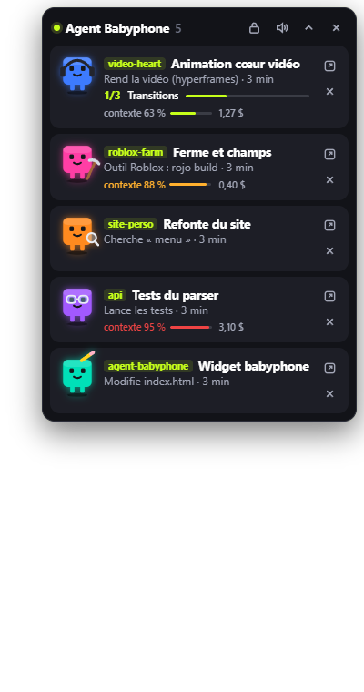
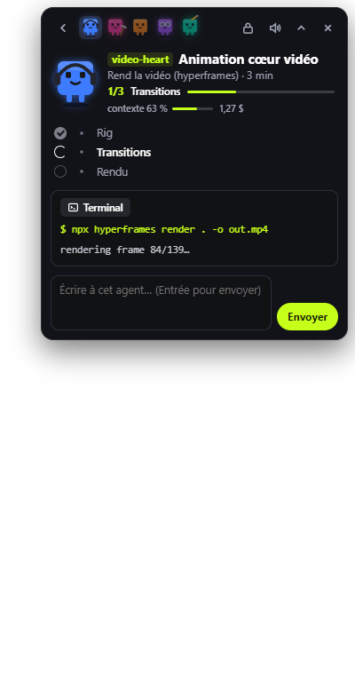
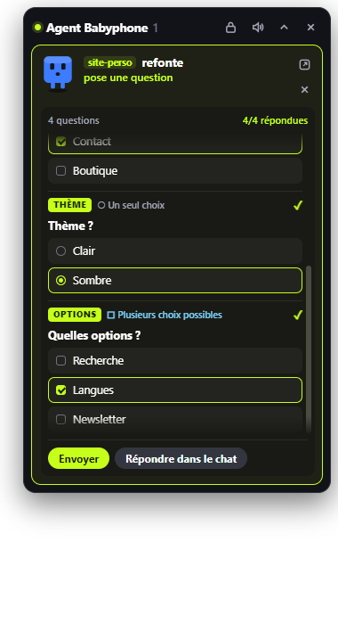

# Agent Babyphone

A small floating window that keeps an eye on your Claude Code agents, like a baby monitor.
See which agents are working and on what, step by step, and approve their permission
requests or answer their questions without opening the chat.

<p>
  
  
  
</p>

## Install

In Claude Code, type:

```
/plugin install agent-babyphone --marketplace CocaB1Frais/agent-babyphone
```

Answer `y` to add the marketplace, pick a scope, then **restart Claude Code**.
The widget appears in the top-right corner of your screen the next time a session starts.
The very first start downloads Electron (about 100 MB), so give it a minute.

From a shell instead:

```
claude plugin install agent-babyphone --marketplace CocaB1Frais/agent-babyphone
```

**Needs:** [Node.js](https://nodejs.org) 18 or newer on your `PATH`. Works on Windows, macOS and Linux
(tested on Windows).

## What it shows

- **Only the agents that matter:** the ones working, the ones waiting for you, and the ones that
  just finished (they stay as "Terminé ✓ · à toi de répondre" until you write to them again).
- **A robot per agent**, dressed for its job: headphones for video work, a pickaxe for Roblox,
  goggles for tests, a magnifier while searching, a pencil while editing.
- **Progress** from the agent's own task list (`2/5 Transitions`), its latest steps written in
  plain words, its last terminal command and output.
- **Context use and cost** of each session; the context gauge turns orange, then red.
- **A small party** when an agent finishes.

## What you can do from it

| Action | How |
| --- | --- |
| Approve or deny a permission request | **Autoriser / Refuser** on the card, or `Ctrl+Alt+A` / `Ctrl+Alt+D` from anywhere |
| Answer an agent's questions | Pick the options (circles = one choice, squares = several) and **Envoyer** |
| Hand a request back to the chat | **Dans le chat** / **Répondre dans le chat** |
| Write to an agent | Open its card, type in the box at the bottom, press Enter |
| Stop an agent | **×** on its card, then **Arrêter** |
| Show or hide the widget | `Ctrl+Alt+H`, the tray icon, or `/babyphone` in Claude Code |
| Move it | Unlock the padlock, drag the header, lock it again |

Hover an agent in the compact view to unfold it; click it to see everything. Click outside to
fold the widget back. It turns half-transparent when nothing is happening.

## How the approvals work

While the widget is running, a permission request or a question from an agent waits up to about
two minutes for your click in the widget. If you don't answer there, or click **Dans le chat**, the
usual dialog shows in the chat as before. When the widget is not running, nothing changes: the
chat asks you as usual. A system notification tells you when an agent needs you while the widget
is hidden.

## Updates

New versions arrive through Claude Code's plugin updates. To update right away:

```
/plugin marketplace update agent-babyphone
```

The widget restarts on the new version by itself at the next session start.

## Privacy

Everything stays on your computer, in `~/.claude/agent-babyphone` (what the agents are doing)
and `~/.agent-babyphone` (the widget). Nothing is sent anywhere, except one short request per new
conversation to Claude Haiku, through your own Claude Code login, to give the conversation a
readable title.

## Troubleshooting

- **No widget:** run `/babyphone`. Still nothing? Look at `~/.agent-babyphone/launch.log`.
- **"needs Node.js":** install Node.js, then run `/babyphone`.
- **Turn off start with the system:** right-click the tray icon, untick *Lancer au démarrage*.

## Uninstall

```
/plugin uninstall agent-babyphone
```

Then quit the widget from its tray icon and delete `~/.agent-babyphone`.

The widget's interface is in French for now.

## License

MIT
